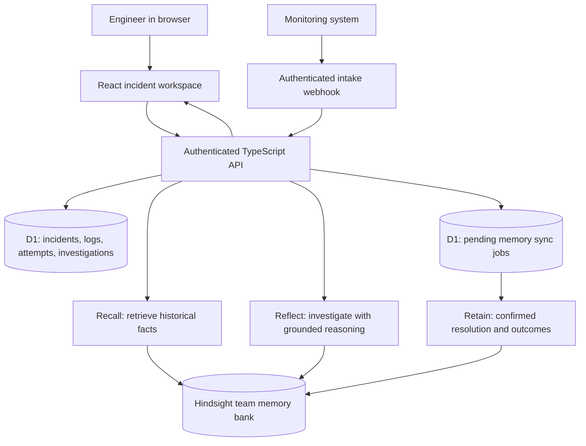

# Recall — complete project roadmap

Prepared 7 November 2026. This is an implementation plan, not a claim that the application or its external connections are complete. The project began from a web-app scaffold; see PHASES.md for verified implementation progress.

## 1. What we are building

**Recall is an incident response workspace that uses Hindsight to learn from confirmed incident resolutions, including unsuccessful fixes.** Its first users are engineers responsible for keeping a company's applications running.

The end-to-end workflow is:

**Report an incident → investigate using historical evidence → record attempted fixes → confirm the resolution → retain the lesson in Hindsight → use it on the next incident.**

The first release supports one team. An engineer can enter actual incidents, paste redacted logs, import incident reports, investigate, record results, and reopen the application later with its data intact. A monitoring webhook adds automatic incident intake after the manual workflow works.

### A concrete example

A shopping platform's payment requests begin timing out. An older incident report says that a leaked database connection exhausted the payment service's connection pool. Restarting the service only helped temporarily; fixing the leak restored normal operation.

Recall retrieves that experience, links its source, and suggests checking connection usage and recent changes. It labels this a historical hypothesis, not a diagnosis of the current system. The engineer confirms what is happening and records the actual outcome. If today's cause is different, that difference becomes part of the memory too.

The application provides investigation guidance. It does not execute production commands or independently verify recovery without a connected source of telemetry.

## 2. Requirements from the hackathon

- Use Hindsight as a real memory system and demonstrate learning over multiple interactions.
- Download and use Band AI desktop during development.
- Target a professional business workflow.
- Submit clean, documented source in a GitHub repository.
- Provide a demo video and demonstrate the running project to judges.
- Explain exactly where Hindsight is used.
- Complete the article, social post, and video required for every team member by the content guide.

The brief weights innovation at 30%, Hindsight use at 25%, implementation at 20%, user experience at 15%, and real-world impact at 10%. Our differentiator is evidence-backed recall of both successful and failed actions, followed by learning from confirmed outcomes.

Source: [the supplied problem statement](https://docs.google.com/document/d/1A4ezag02em823ZzYF34DiUVHUNLWI5ztm70QvWidWoQ/edit). The separate content guide still needs to be obtained from the organizers; its detailed rules were not included in the supplied document.

## 3. Selected technology stack

- **Language:** TypeScript across the browser and backend.
- **UI:** React, Tailwind CSS, accessible shadcn-style components, and Lucide icons.
- **Application framework:** The existing Vinext/Vite starter, which implements Next.js-style pages and API routes. Keep frontend and backend in one repository and deployment. The current scaffold already uses this stack. [Vinext source and documentation](https://github.com/cloudflare/vinext).
- **Backend:** Server-side TypeScript route handlers. These validate requests, enforce access, call the database and Hindsight, and return results.
- **Operational database:** Cloudflare D1 with Drizzle ORM and versioned migrations. D1 is managed SQL storage with SQLite semantics. [D1 documentation](https://developers.cloudflare.com/d1/).
- **Agent memory and initial reasoning:** Hindsight Cloud, accessed through its documented HTTP API from the server.
- **Hosting:** Sites deployment using Cloudflare Workers and a D1 binding; preserve the existing Site project identity. Configure runtime secrets separately from source code. Keep access restricted during development and verify how judges will access the final project.
- **Validation:** Zod for input and generated-output validation.
- **Tests:** Focused unit tests, live integration checks, and browser workflow tests; Playwright if available in the development environment.
- **Development and submission:** Git, GitHub, Band desktop, and a screen recorder.

Hindsight Cloud includes the underlying LLM, embedding, and reranking services. Its Reflect operation can supply the initial reasoning layer, so a separate Groq/OpenAI account is optional. We do not need our own vector database or GPU. [Hindsight Cloud documentation](https://hindsight.vectorize.io/cloud-enterprise/hindsight-cloud).

## 4. Accounts and configuration

### Hindsight Cloud

1. Sign up at [Hindsight Cloud](https://ui.hindsight.vectorize.io) and complete verification.
2. Create an organization for the team.
3. Create a memory bank called `Recall Incidents`; record the actual bank ID.
4. Create an API key and copy the connection URL from the account's connection instructions.
5. Configure the application's server-side environment.
6. Run an isolated retain → recall → reflect smoke test before building the dashboard.

Follow the [official getting-started instructions](https://docs.hindsight.vectorize.io/cloud/getting-started/). The brief lists promo code `MEMHACK99`; check whether it is accepted in the account's billing screen rather than assuming the credit is available.

Use these application-owned configuration names:

```dotenv
HINDSIGHT_BASE_URL=<actual API base URL>
HINDSIGHT_API_KEY=<private API key>
HINDSIGHT_BANK_ID=<actual bank ID>
WEBHOOK_SECRET=<random private intake secret>
```

For the current Worker-based scaffold, keep local secrets in an ignored `.dev.vars` file and configure corresponding deployment secrets for hosting. The D1 database is a `DB` binding, not a client-visible password. These environment variable names are conventions our application will read; setting them alone does not implement the connection. Never put the Hindsight key into browser code or a `NEXT_PUBLIC_*` variable.

### Band desktop

1. Download the correct installer for the computer.
2. Complete the setup wizard and sign in.
3. Connect an installed coding agent supported by the app.
4. Use a project room for genuine development or review work.
5. Keep a screenshot or work record for the project write-up.

Band desktop is part of the development workflow. It does not need to become an additional runtime dependency of Recall. [Official Band installation instructions](https://docs.band.ai/band-desktop/install).

### GitHub and hosting

Create a repository, keep secrets ignored, verify the production deployment, and check access from a separate browser session. A deployment URL alone does not prove judges can open a private application.

## 5. Architecture



**D1 stores the application records:** original reports, exact log excerpts, status, timestamps, action outcomes, generated investigations, and sync state.

**Hindsight supplies long-term memory:** extracted incident knowledge and the memory-based recall/reflection used during investigation. Retain does not replace the application's original source records. [Retain documentation](https://hindsight.vectorize.io/developer/api/retain).

All Hindsight calls happen on the server. The browser receives only approved application data and results. For a first single-team release, use authenticated access and a fixed server-controlled bank ID. Do not let the browser choose arbitrary memory banks. If we later add multiple organizations, add verified membership checks and separate bank mappings.

### The three Hindsight operations

- **Retain:** Save the confirmed cause, successful fix, failed attempts, service, version, environment, and incident ID.
- **Recall:** Retrieve related facts for an evidence browser and investigation context. [Recall documentation](https://hindsight.vectorize.io/developer/api/recall).
- **Reflect:** Request a grounded investigation, distinguishing current observations from historical patterns and unverified hypotheses. It performs its own memory search; use the evidence returned for that reflection to substantiate its answer. A separate recall result is not automatically evidence that Reflect used the same facts. [Reflect documentation](https://hindsight.vectorize.io/developer/api/reflect).

## 6. Data model

Use the following records, linked by IDs:

- `services`: name, environment, owner, description.
- `incidents`: ID, service ID, title, symptoms, severity, status, reporter, created/updated/resolved timestamps.
- `incident_events`: incident ID, event type, actor, timestamp, note or redacted log text.
- `action_attempts`: incident ID, action, outcome (`worked`, `failed`, `partial`, `unknown`), evidence, timestamp.
- `investigations`: incident ID, context revision, hypothesis list, checks, precautions, generated summary, source references, provider, timestamp.
- `resolutions`: incident ID, confirmed cause, successful fix, verification evidence, preventive action, author, version.
- `memory_sync_jobs`: incident/resolution version, document ID, status, retry count, next retry time, last error, synced timestamp.
- `webhook_events`: provider and external event ID, received timestamp, mapped incident ID; enforce a unique key for deduplication.

Store authentication identifiers and ownership on records where required. Keep membership explicit if the app expands beyond one team.

## 7. Screens and UI direction

Build five main screens:

1. **Overview:** Active incidents, severity, service filters, and recent learning activity. Derive counts from real records.
2. **Incident workspace:** Incident details and timeline on the left, investigation in the center, memory evidence on the right. On smaller screens these become tabs or stacked panels.
3. **Memory library:** Searchable historical knowledge with links to source reports, dates, services, and outcomes.
4. **Resolution form:** Cause, fix, unsuccessful attempts, verification, prevention, and visible memory-sync status.
5. **Connections:** Configuration status, live connection test, last successful operation, and retry controls for failed memory syncs. Do not display secret values.

Use a restrained engineering-console design: readable typography, generous spacing, neutral surfaces, one accent color, and severity colors used consistently. Support keyboard navigation, clear focus states, loading states, useful errors, and readable log formatting.

Every visible button must perform a real action. Avoid fabricated confidence percentages, simulated progress presented as processing, or invented time-saved claims.

## 8. Implementation roadmap

Estimates below are planning estimates, not delivery guarantees. Allocate roughly **24 focused engineering hours plus 6 hours of contingency**. With unfamiliar tools or account delays, allow more time.

### Phase 1 — accounts and live memory proof (about 1 hour)

- Set up Hindsight Cloud, bank, API key, Band desktop, and repository access.
- Retain a small test report in a dedicated development bank.
- Recall it and obtain a live Reflect answer.
- Confirm secret storage and record the successful request IDs/statuses without logging the key.

**Exit check:** A new server process retrieves information retained by an earlier process. Merely showing “Connected” is insufficient.

### Phase 2 — app foundation (about 2 hours)

- Use the scaffold under `recall/`; verify the dependency installation.
- Replace starter metadata and establish layout, navigation, and shared components.
- Enable the D1 binding, define schema, generate and apply local migrations.
- Configure authenticated access and server-only environment handling.

**Exit check:** The app runs locally and can persist and reload a simple record.

### Phase 3 — incident workflow (about 3 hours)

- Implement create, list, filter, update, and detail APIs and screens.
- Add log/event entry, action outcomes, status transitions, and input validation.
- Support report import as bounded plain text, Markdown, or JSON; save the original record.
- Add a real resolution form before adding AI features.

**Exit check:** A person can report, investigate manually, resolve, and reopen an incident with the history preserved.

### Phase 4 — reliable memory ingestion (about 3 hours)

- Convert confirmed resolutions into clearly labelled memory documents.
- Include known failed attempts and their conditions rather than treating every failure as a universal rule.
- Assign a stable document ID per incident and retain corrections as source updates.
- Save the resolution and a pending sync job together in D1.
- Implement retries, a scheduled or explicit retry path, and visible pending/synced/failed states.
- Mark a memory as synced only after processing is actually complete. If using asynchronous retain, track its operation until completion.

**Exit check:** A failed Hindsight request preserves the resolution, reports the failure, and can be retried without creating duplicate incident records.

### Phase 5 — grounded investigation (about 4 hours)

- Assemble current symptoms, log excerpts, service, environment, and recorded attempts.
- Add Recall evidence retrieval and Reflect investigation generation.
- Request structured output where supported and validate it with Zod.
- Return a summary, hypotheses, supporting references, checks, historical failed actions, and missing information.
- Preserve evidence provenance; resolve fact/document references to stored incident reports.
- Display insufficient evidence honestly. If Hindsight is unavailable, show the error and retry action rather than substituting a canned live answer.
- Store each investigation with the input revision so older results cannot be mistaken for a fresh analysis of changed logs.

**Exit check:** A matching report yields an evidence-backed hypothesis; unrelated symptoms do not produce an invented historical fix.

### Phase 6 — interface and memory exploration (about 3 hours)

- Complete the five screens and responsive layouts.
- Make source references inspectable with dates and original context.
- Finish search, filters, form validation, and connection diagnostics.
- Show actual learning events such as a newly synced resolution.

**Exit check:** A new user can create and investigate an incident without developer assistance.

### Phase 7 — automatic intake (about 3 hours)

- Implement one authenticated webhook receiver.
- Define a small generic event contract, validate size and required fields, and reject unauthorized calls.
- Deduplicate provider/event IDs and map events to services.
- Test with a genuine HTTP sender, then connect one available monitoring tool. A generic receiver is not a claim of PagerDuty/Sentry integration until that provider is actually configured and verified.

**Exit check:** Sending one event creates one incident; retrying the same event does not create a duplicate.

### Phase 8 — verification and deployment (about 3 hours)

- Run the focused tests listed below and production build.
- Apply production migrations and configure production secrets.
- Deploy, then test live create → investigate → resolve → retain → new investigation.
- Verify authentication, judge access, browser refresh, and persistence across sessions.

**Exit check:** The hosted application completes its real workflow against Hindsight without development-only resources.

### Phase 9 — submission (about 2 hours)

- Write setup instructions, architecture, memory explanation, limitations, and test evidence.
- Add `.dev.vars.example` with placeholders; keep actual credentials ignored.
- Record the working app and Hindsight evidence.
- Prepare the article, social post, and team-member videos against the organizers' content guide.
- Publish source to GitHub and verify repository and project links.

**Exit check:** A reviewer can follow the README and understand both how it works and what has actually been verified.

## 9. Proposed API and source layout

Suggested routes:

```text
GET    /api/incidents
POST   /api/incidents
GET    /api/incidents/:id
PATCH  /api/incidents/:id
POST   /api/incidents/:id/events
POST   /api/incidents/:id/attempts
POST   /api/incidents/:id/investigate
POST   /api/incidents/:id/resolve
POST   /api/imports
GET    /api/memories?q=...
GET    /api/connections/status
POST   /api/connections/test
POST   /api/memory-sync/:jobId/retry
POST   /api/webhooks/incidents
```

These are planned application routes. Browser-facing routes require the configured app access checks; the webhook uses a separate secret and deduplication. Resolve/retry/import operations should enforce idempotency or unique source versions as appropriate.

```text
recall/
  app/
    page.tsx
    incidents/[id]/page.tsx
    memories/page.tsx
    connections/page.tsx
    api/...
  components/
    incident-list.tsx
    investigation-panel.tsx
    evidence-panel.tsx
    resolution-form.tsx
  lib/
    hindsight.ts
    investigation.ts
    validation.ts
    auth.ts
    memory-sync.ts
  db/
    schema.ts
    index.ts
  drizzle/
  tests/
  docs/
    ARCHITECTURE.md
    HINDSIGHT.md
    DEMO-SCRIPT.md
  .dev.vars.example
  README.md
  ROADMAP.md
```

## 10. Tests that establish a working project

- Create and edit incidents, then refresh and restart the app; records remain.
- Retain a report and retrieve it in a later session through Hindsight.
- Investigate a recurring issue and verify source references match retained information.
- Investigate a novel issue and verify insufficient evidence is surfaced.
- Record a failed attempt; a later relevant investigation acknowledges its actual context.
- Record a new confirmed outcome and verify it affects a later investigation.
- Test a corrected resolution; it must not leave the old source version presented as current truth.
- Simulate provider timeout, invalid key, and failed retain; preserve records and show actionable errors.
- Retry sync and repeated webhook delivery; verify deduplication.
- Verify protected writes and secret handling; inspect browser bundles and Git for accidental credentials.
- Test required fields, oversized logs/imports, responsive layouts, keyboard operation, and the deployed URL.

Build a small evaluation set across payment/database exhaustion, Redis/cache faults, queue backlogs, and one unrelated incident. Measure source correctness, relevant recall, acknowledgement of failed fixes, and honest handling of missing evidence. Do not claim a measured reduction in recovery time without a suitable evaluation.

## 11. How to show real learning to judges

1. Open a real incident workflow with no relevant history in a clean development bank. The agent should acknowledge the missing history.
2. Record a verified resolution, including a failed action, and show successful retain processing in Hindsight.
3. Start a new session and create a related incident.
4. Investigate it and inspect the earlier source and outcome in the answer.
5. Add a new outcome or correction and show the next investigation incorporating that evidence.

This is a demonstration of the working application, not a separate mocked demo implementation. Label any synthetic incident reports as synthetic. If a controlled no-memory comparison is added, hold the model, incident input, and prompt constant, changing only memory access; do not compare live reasoning to a hardcoded baseline as though it were an experiment.

## 12. Completion criteria and what can wait

The project is ready when the deployed application accepts user data, persists records, performs live Hindsight retain/recall/reflect operations, cites evidence, learns from a new resolution across sessions, handles integration errors, has working intake, and has reproducible setup and submission materials.

Keep these for later: autonomous remediation, multiple agents, Slack bots, multiple monitoring providers, Kubernetes deployment, PDF/OCR pipelines, predictive outage claims, and multi-organization billing. They are not needed to complete the chosen workflow.

The immediate first task is **create the Hindsight Cloud organization and bank, configure a private API key, and pass the live memory smoke test**. This removes the most important project dependency before substantial UI work.
