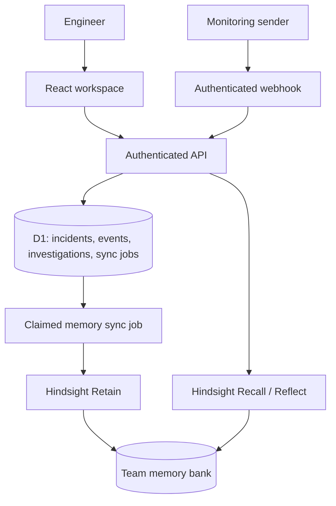

# Architecture

React + TypeScript renders the workspace. Vinext supplies Next.js-style server pages and route handlers on Vite. The Cloudflare Worker hosts the same application and reads D1 and runtime secrets from environment bindings.

The catch-all route in `app/api/[...path]/route.ts` delegates to `lib/server.ts`. Input schemas are in `lib/validation.ts`, provider handling in `lib/hindsight.ts`, and Drizzle tables in `db/schema.ts`.

## Identity

The first release is one shared team workspace, deployed owner-private. Hosted request identity comes from the Sites platform. Browser API requests require sign-in; writes reject a mismatched Origin. A loopback-only development exception is active only in development mode. Changing the site's audience does not turn this implementation into a multi-tenant service; add explicit membership and per-organization bank mappings before doing so.

The webhook uses its own constant-time digest comparison for a private Bearer secret and deduplicates provider/event ID pairs. Private hosting also requires the caller's platform service access header; the application secret does not bypass hosting access control.

## Persistence and concurrency

Incidents have monotonically increasing revisions. Resolution updates are conditional on the expected revision. A database batch saves the resolution, memory job and event together. Conditional inserts prevent a revision race from creating an orphan job. Each memory job records the snapshot being retained and its processing state. Original incident data remains available even if Hindsight fails.

## Boundaries

Recall recommends diagnostic checks. It does not execute production commands, continuously monitor infrastructure, prove recovery without evidence, or measure time saved. A generic monitoring receiver is implemented; a named monitoring-provider integration requires configuring and verifying that provider.
